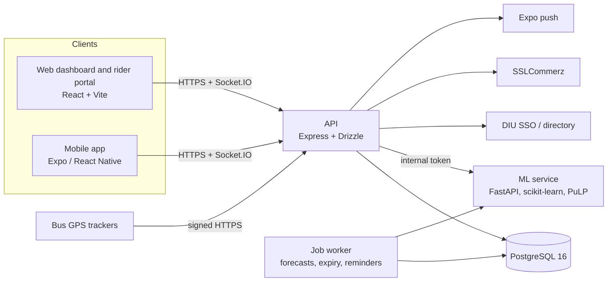

# DIU Smart Transport

[](https://github.com/MuzahidRezwan/diu-smart-transport/actions/workflows/ci.yml)

Bus transport for Daffodil International University: an authority dashboard, a student and faculty app, and a model that predicts how many people will ride each trip so the transport office can send the right buses at the right time, instead of sending one bus and waiting until it is full.

## Live demo

The whole system (dashboard, student/faculty app, ML model) with sample data, on one port:

- **Your computer, one command** (Node 22 and Python 3.11+, Windows/macOS/Linux):
  ```bash
  git clone https://github.com/MuzahidRezwan/diu-smart-transport && cd diu-smart-transport
  npm run demo                 # then open http://localhost:7860
  npm run demo -- --public     # also prints a public https://….trycloudflare.com link for others
  ```
  The first run installs and trains the model (a few minutes); later runs start in about a minute. The public link works while the command keeps running.
- **Hugging Face Space** (permanent public link): published by the [Deploy demo](.github/workflows/deploy-demo.yml) workflow once the `HF_TOKEN` secret is set ([setup](docs/12-deployment-and-ops.md#1213-public-demo)).
- **GitHub Codespaces** (no extra account): [](https://codespaces.new/MuzahidRezwan/diu-smart-transport?quickstart=1). The demo opens on port 7860 after the first build (about 5 minutes).
- **Docker:** `docker build -f deploy/demo/Dockerfile -t diu-demo . && docker run -p 7860:7860 diu-demo`, then http://localhost:7860.

Sign in as the transport office with *Fill in* on the login page (`710215` / `diu-demo-2026`, no 2FA in the demo), or as a rider with `232-35-797` (student) or `710410` (faculty) on the stand-in university page. Sign-in and payments are simulated, and the data resets when the demo restarts.

## What it does

**Transport office (web dashboard)**
- Today's and the next 7 days' predicted riders in and out, per route, direction, time slot and audience, with the buses needed as only Hanif / only Monir / only Surjomukhi / mixed
- Allocate buses slot by slot or *suggest* a whole day (optimizer), then publish; a bus already busy in an overlapping trip is never offered
- Fleet, availability, routes, stops and time slots; semesters, fees and holidays. Seeded with DIU's published timetable, Friday trips included ([assumptions](docs/10-risks-and-assumptions.md#102-assumptions-made-in-this-design))
- Card requests (auto-approved after payment), one-day passes (first one per semester automatic), free access with a reason
- Payments page with a daily list and Excel/CSV download; complaints and help requests; notices to everyone or one route; live bus map
- Co-admins with fine-grained permissions, mandatory 2FA, full audit log

**Students, faculty and staff (Android/iOS app and web)**
- Sign in with the university account (SSO); no separate password
- *My Bus*: the next bus for their route with the published bus numbers; full day schedule; route map and live buses
- Transport card with a rotating QR code that works offline; pay the semester fee (SSLCommerz: card, bKash, Nagad, Rocket) or request a one-day pass
- Notices by push, complaints and help with replies

**Supervisors** scan cards at the bus door; every scan becomes training data for the model.

**Privacy by design.** The transport office sees transport data only: ID, name, route, card and payment status. It cannot open a student's profile, sign in as a student or change anything inside a student's account. This is enforced by the permission list, by the API, by a database view and by separate database roles, and CI tests it on real PostgreSQL ([security plan](docs/07-security.md#authority-data-boundary-no-profile-access-no-impersonation)).

## How the prediction works

1. **Routine count** (rules): each card holder's batch and section (or teacher initial) is matched to the department class routine, giving the maximum number of people who could need each trip.
2. **Ridership forecast** (ML): gradient-boosted trees learn the share who actually ride, from boarding scans, weekday, exams and holidays, with a 90th-percentile estimate so seats cover about 9 days in 10. Until enough scans exist, a configurable attendance factor is used.
3. **Allocation** (optimization): a mixed-integer program picks buses for the day, reusing them across slots when the trips do not overlap. The office reviews and publishes; the prediction is a suggestion.

On synthetic data the model cuts the error from 12.6% to 9.0% WAPE against the per-trip historical average and keeps P90 coverage at 90%. Details: [ML design](docs/06-ml-design.md).

## Architecture



```
apps/api         Express API and job worker (TypeScript, Drizzle ORM, PostgreSQL or PGlite)
apps/web         Authority dashboard and rider portal (React, Vite, Tailwind)
apps/mobile      Student/faculty app and supervisor scanner (Expo)
packages/shared  Types, zod schemas, permissions, time and bus calculations used by all three
services/ml      Routine parser, ridership model, allocation optimizer (Python, FastAPI)
docs             Specification, design and operations
design/prototype Clickable HTML prototype of the dashboard and app
infra            Caddy and Postgres setup for docker compose
scripts          Secret guard, backup and restore
```

## Run it locally

Needs Node 22 and Python 3.12. No database server or university access is required: development uses an embedded PostgreSQL (PGlite) and mock SSO, directory and payment gateway.

```bash
npm ci                                   # also turns on the git hooks that block secrets
npm run build -w @diu/shared

cp apps/api/.env.example apps/api/.env   # then set JWT_SECRET and DATA_ENCRYPTION_KEY (commands are in the file)
npm run db:seed -w @diu/api              # DIU's 13 routes and timetable, 51 buses, fees; prints the admin password once
npm run db:demo -w @diu/api              # optional: 940 riders with cards, payments, routines, tickets

npm run dev:api                          # http://localhost:4000
npm run dev:web                          # http://localhost:5173
```

ML service (optional; without it the API uses the routine count and a simple allocation):

```bash
cd services/ml
python -m venv .venv && .venv/bin/pip install -r requirements.txt
.venv/bin/python -m app.train --synthetic          # trains a model on generated data
.venv/bin/uvicorn app.main:app --port 8000
```

Mobile app: `cd apps/mobile && npm ci && EXPO_PUBLIC_API_URL=http://<your computer's LAN IP>:4000 npx expo start`, then open it in Expo Go. To sign in from Expo Go, set `MOBILE_REDIRECT_URI` in `apps/api/.env` to the `exp://<LAN IP>:8081/--/auth` address (installed builds use `diutransport://auth`).

**Signing in.** Transport office: ID `710215` with the password printed by `db:seed`, then scan the 2FA QR code with any authenticator app. Rider: *University sign-in*, then type any ID such as `221-15-443` on the mock university page.

## Tests

```bash
npm test                                   # shared + API (PGlite)
TEST_PG_URL=postgres://postgres@localhost:5432/postgres npm test -w @diu/api   # API on real PostgreSQL with the production roles
cd services/ml && .venv/bin/python -m pytest
cd apps/mobile && npx tsc --noEmit && npm run bundle:android
```

CI runs all of these on every push, plus the secret scan (own guard and gitleaks over the full history) and dependency audits.

## Deploy

One machine with docker compose: PostgreSQL with least-privilege roles, API, job worker, ML service, web and an optional Caddy edge with automatic HTTPS.

```bash
cp .env.example .env && cp .env.api.example .env.api    # fill in every value
docker compose --profile edge up -d --build
```

Step-by-step setup, configuration, backups, ML retraining, runbooks and the go-live checklist: [Deployment and operations](docs/12-deployment-and-ops.md).

## Keeping secrets out of git

`.env` files, keys, credentials, database dumps, backups and ML training exports never belong in this repository. A pre-commit and pre-push hook ([`scripts/check-secrets.mjs`](scripts/check-secrets.mjs)) refuses them, and CI scans the whole history again with gitleaks. Only `*.example` files with `change-me` placeholders are committed. See [SECURITY.md](SECURITY.md).

## Documentation

| | |
|---|---|
| [01 Requirements](docs/01-requirements.md) | Functional and non-functional requirements |
| [02 Architecture](docs/02-architecture.md) | Components, data flows, deployment view |
| [03 Tech stack](docs/03-tech-stack.md) | Choices and reasons |
| [04 Database schema](docs/04-database-schema.md) | Tables, privacy roles, indexes, retention |
| [05 API reference](docs/05-api-reference.md) | Every endpoint, permission, error code and realtime event |
| [06 ML design](docs/06-ml-design.md) | Data, features, models, evaluation, retraining, optimizer |
| [07 Security](docs/07-security.md) | Authentication, authorization, privacy boundary, payments |
| [08 Missing features](docs/08-missing-features.md) | What else the system needs and why |
| [09 Roadmap](docs/09-roadmap.md) | Phases, team roles, timeline |
| [10 Risks and assumptions](docs/10-risks-and-assumptions.md) | What to get from the university before going live |
| [11 UI/UX](docs/11-ui-ux.md) | Layout decisions and improvements to the sketches |
| [12 Deployment and operations](docs/12-deployment-and-ops.md) | Running, monitoring and recovering the system |

## Status

The code runs end to end with mocks. Going live needs, from the university: SSO (OIDC) and directory API access, an SSLCommerz merchant account, the real bus list and seat counts, routes and timings, routine sources, and written approval for the data use ([what to ask for](docs/10-risks-and-assumptions.md#101-what-to-ask-the-university-for-before-writing-production-code)). The model starts with the routine count and learns once supervisors scan cards on the buses.
