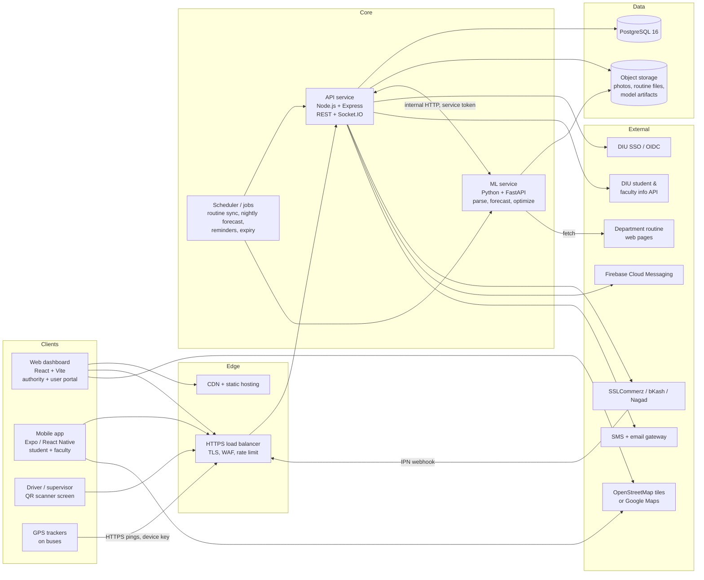
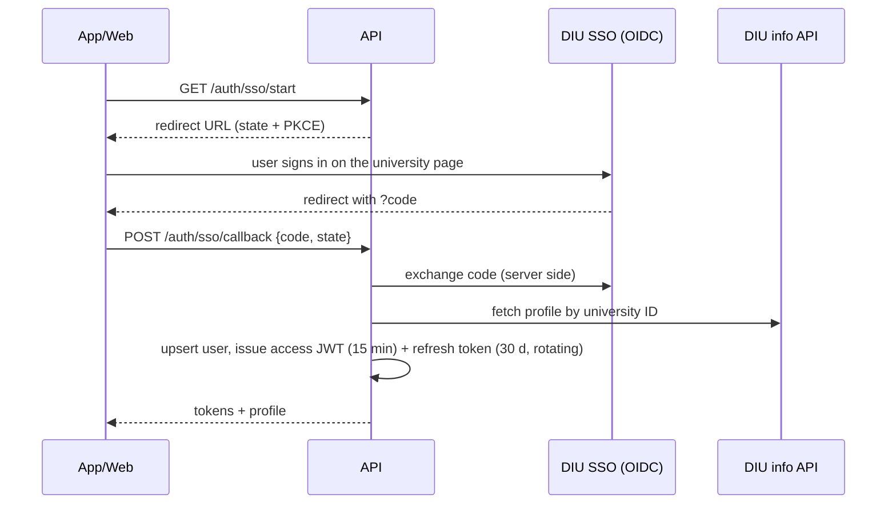
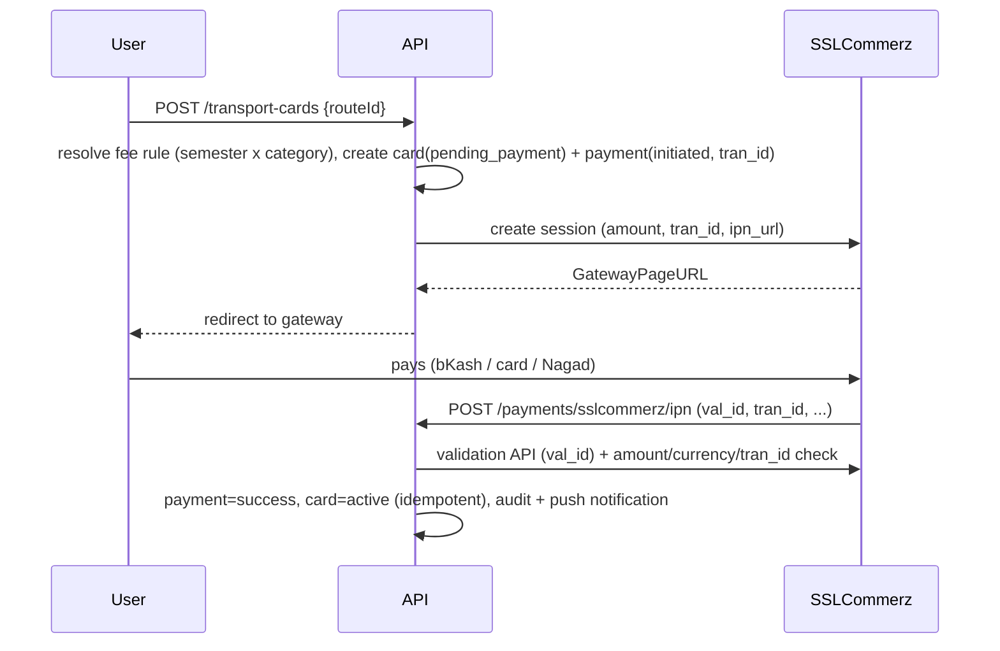
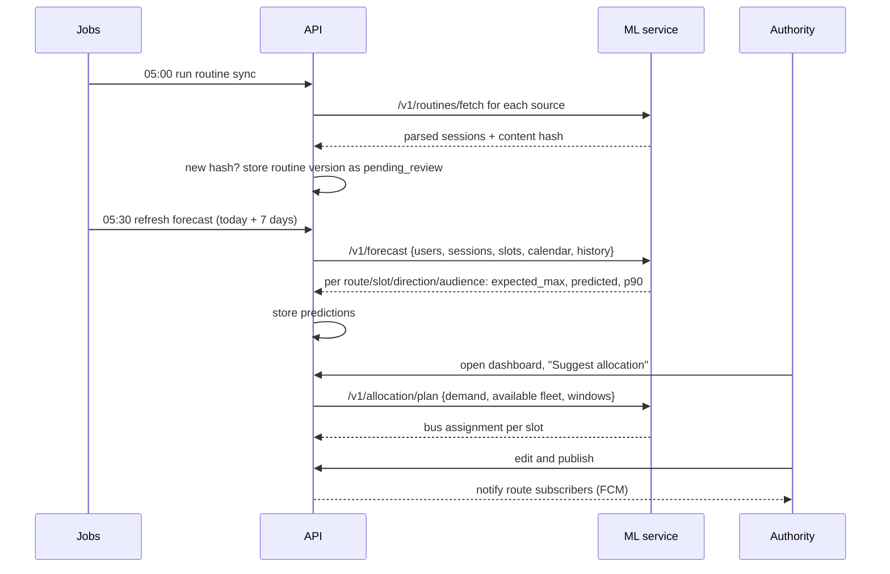

# 2. System Architecture

## 2.1 Overview



## 2.2 Components

| Component | Responsibility | Owns data? |
|---|---|---|
| **API** (`apps/api`) | Auth, RBAC, every business rule (cards, passes, fees, payments, allocation conflicts), REST endpoints, Socket.IO for live bus positions, push notifications, audit log. | Yes, the whole `public` schema. |
| **Jobs** (inside `apps/api`, `src/jobs`) | Cron-style tasks: daily routine sync, nightly 7-day forecast refresh, card expiry, renewal reminders, GPS ping retention. Runs in a separate process (`node dist/jobs/worker.js`) so it can be scaled to exactly 1 replica. | No (uses API services). |
| **ML service** (`services/ml`) | Stateless compute: parse routines (CSV/XLSX/PDF/HTML), compute rule-based expected demand, forecast real ridership with a gradient-boosting model, solve the bus allocation optimization. Stores only model artifacts. | Model artifacts only. |
| **Web** (`apps/web`) | Authority dashboard (prediction panel, allocation, approvals, live map, notices, admin management) and a browser version of the user portal. | No. |
| **Mobile** (`apps/mobile`) | Student/faculty app: My Bus, Live Route, My Card (QR), Notifications, side menu. Driver mode for boarding scans. | Offline cache only. |
| **Shared** (`packages/shared`) | TypeScript types, enums, permission catalogue, zod request schemas and the bus-requirement calculator, used by API, web and mobile. | No. |

**Why the ML service is stateless:** the API is the single owner of data. It gathers what the ML service needs (transport users, routine sessions, slots, history, calendar), sends it, and stores the result. This keeps one migration history, one backup and one place for access control, and lets the ML service be redeployed or retrained without touching the database.

## 2.3 Key flows

### Sign-in (student/faculty)


### Card purchase


### Daily prediction and allocation


## 2.4 Deployment view

- **Small (MVP, < 10k users):** one VM (4 vCPU / 8 GB) with Docker Compose: `api`, `jobs`, `ml`, `web` (static via Caddy/Nginx), `postgres` with daily off-site backups.
- **Production:** API ×2–4 replicas behind a load balancer, Socket.IO with the Redis adapter, managed PostgreSQL with a read replica for reports, ML ×1 (CPU is enough), object storage (S3-compatible), CDN for the web build. See [12-deployment-and-ops.md](12-deployment-and-ops.md).

## 2.5 Repository layout

```
apps/
  api/        Express API + jobs worker (TypeScript, Drizzle ORM)
  web/        Authority dashboard + user portal (React, Vite, Tailwind)
  mobile/     Student/faculty app (Expo, React Native)
packages/
  shared/     Types, enums, permissions, zod schemas, bus calculator
services/
  ml/         FastAPI service: routine parsing, forecasting, optimization
docs/         This specification
infra/        Docker, Caddy, deployment notes
```
