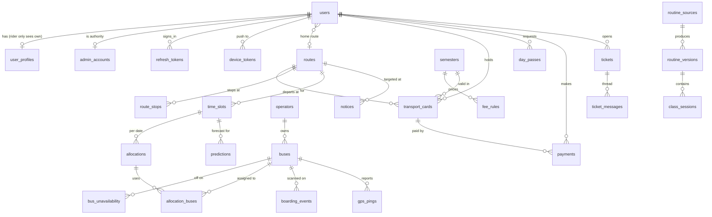

# 4. Database Schema

PostgreSQL 16. The source of truth is [`apps/api/src/db/schema.ts`](../apps/api/src/db/schema.ts) (Drizzle ORM); migrations are in [`apps/api/drizzle`](../apps/api/drizzle). In development and tests the same migrations run on PGlite (Postgres compiled to WebAssembly), so no database server is needed.

Conventions:

- Primary keys are UUIDs (`gen_random_uuid()`), except the two high-volume logs (`gps_pings`, `audit_logs`), which use `bigserial`.
- All timestamps are `timestamptz`. Service dates are plain `date` in Asia/Dhaka.
- Times of day are stored as **minutes after midnight** (`departure_minutes = 420` is 7:00 AM). This makes overlap checks simple integer comparisons.
- Money is stored as whole taka (`integer`), never as floating point.
- Secrets in rows (TOTP seeds, QR seeds, GPS device keys) are AES-256-GCM encrypted with `DATA_ENCRYPTION_KEY`; columns are named `*_enc`.
- Tokens and one-time codes are stored as SHA-256 hashes only.

## 4.1 Entity overview

## 4.2 Tables

### People and sign-in

| Table | Purpose | Key columns and rules |
|---|---|---|
| `users` | Identity of every person (rider or authority). **No contact or academic data.** | `university_id` unique; `role` (`student`, `faculty`, `staff`, `supervisor`, `authority`); `category` decides the fee; `home_route_id`; `is_active` |
| `user_profiles` | Profile synced from the university directory at each sign-in: department, program, batch, section, teacher initial, designation, phone, email, photo | 1:1 with `users`. Read only by the rider themself and by the forecast job (pseudonymised before it leaves the API). The `transport_admin` DB role has **no grant** on it. |
| `admin_accounts` | Authority login: designation, bcrypt hash, TOTP seed (encrypted), main-admin flag, permission list, lockout counters | `must_change_password` on first login; `failed_attempts` / `locked_until` for lockout |
| `refresh_tokens` | Rotating refresh tokens | `token_hash` unique; `family_id` groups a chain. Reusing a used token revokes the whole family. |
| `auth_handoffs` | Short-lived one-time values: OAuth `state` + PKCE verifier, login hand-off codes, 2FA challenges | `key_hash` unique, `expires_at`, `used_at` (single use) |
| `device_tokens` | Expo/FCM push tokens per device | `token` unique |

### Academic calendar and routines

| Table | Purpose | Key columns and rules |
|---|---|---|
| `semesters` | Fee and card validity period | `code` unique; one row has `is_current = true` |
| `calendar_events` | Holidays, exams, registration, closures | `cancels_service` removes buses that day; exam weeks are a model feature |
| `routine_sources` | Department routine URLs checked daily | `kind` (`html`, `pdf`, `xlsx`, `csv`, `upload`); `last_hash` detects changes |
| `routine_versions` | Each parsed routine file | `status`: `pending_review` → `active` (old one becomes `superseded`) or `rejected`; `warnings` from the parser |
| `class_sessions` | One class meeting from a routine version | department, batch, section, teacher initial, weekday, start/end minutes, course, room |

### Fleet, routes and schedule

| Table | Purpose | Key columns and rules |
|---|---|---|
| `operators` | Hanif (H), Monir (M), Surjomukhi (S), … | `code` unique |
| `buses` | Each bus | `code` unique (e.g. `H-10`); `seat_capacity` (configurable, so unknown Surjomukhi sizes are fine); driver name/phone; `gps_device_id` + encrypted device key; `pool` (`student` or `faculty`) |
| `bus_unavailability` | Bus off the road for a date range (repair, fitness) | Removed from "available" for those dates |
| `routes` | DSC ↔ Mirpur, Uttara, Dhanmondi, …, and shuttles | `kind` (`regular`, `shuttle`); `duration_minutes` and `turnaround_minutes` drive the busy-window calculation |
| `route_stops` | Ordered stops with coordinates for the route map | unique (`route_id`, `seq`) |
| `time_slots` | A fixed departure: route + direction + audience + time + weekdays | `departure_minutes`; `weekdays` array (0 = Sunday); optional `semester_id` for semester-specific timetables |

### Prediction and allocation

| Table | Purpose | Key columns and rules |
|---|---|---|
| `predictions` | Model output per date and slot | `expected_max` (routine count), `predicted` (mean), `p90`, `model_version`. Unique (`service_date`, `time_slot_id`) |
| `allocations` | The authority's decision for one slot on one date | `status`: `draft` → `published` (riders see it) or `cancelled`. Unique (`service_date`, `time_slot_id`) |
| `allocation_buses` | Buses in an allocation, with the bus's **busy window** in minutes | PK (`allocation_id`, `bus_id`); the API refuses a bus whose window overlaps another allocation of the same bus on the same date |

The busy window is computed in [`packages/shared/src/time.ts`](../packages/shared/src/time.ts): a to-campus trip occupies the bus from departure to arrival plus turnaround; a from-campus trip occupies it until it is back at DSC (twice the route duration). The same function runs in the dashboard (to grey out buses) and in the API (to enforce the rule).

### Cards, passes and payments

| Table | Purpose | Key columns and rules |
|---|---|---|
| `fee_rules` | Semester fee per category | Unique (`semester_id`, `category`); edited by authority with `fees.manage` |
| `transport_cards` | A rider's card for one semester and one route | `status`: `pending_payment`, `pending_approval`, `active`, `rejected`, `revoked`, `expired`; `source`: `payment` (auto-approved), `authority_grant` (free access), `manual_approval`. Unique (`user_id`, `semester_id`). `qr_secret_enc` seeds the rotating QR code. |
| `day_passes` | One-day pass | Passes up to the `dayPassLimitPerSemester` setting (default 1) are auto-approved; after that `dayPassOverLimit` decides between rejecting and manual approval. Unique (`user_id`, `travel_date`). |
| `payments` | Every gateway transaction | `tran_id` unique (idempotency key); `status`: `initiated` → `success` / `failed` / `cancelled` → `refunded`; gateway IDs and the raw IPN for reconciliation. Success is set by a **conditional update** (`WHERE status = 'initiated'`) after server-side validation, so a replayed IPN cannot double-activate. |

### Operations and support

| Table | Purpose | Key columns and rules |
|---|---|---|
| `boarding_events` | Each QR scan on a bus (valid or rejected, with reason) | The ground truth that trains the model |
| `gps_pings` | Bus positions | Index (`bus_id`, `recorded_at`); keep 90 days, then aggregate (see [12](12-deployment-and-ops.md)) |
| `notices` | Notices to all, students, faculty or one route | `audience`, optional `route_id` |
| `tickets`, `ticket_messages` | Complaints, suggestions, help requests and replies | `number` unique: `C-1001…` for complaints and suggestions, `H-1001…` for help, taken from the sequences `ticket_complaint_seq` and `ticket_help_seq` so concurrent requests never get the same number; `read_by_staff` drives the unread badge; `hide_identity_from_driver` |
| `settings` | Configurable rules as JSON, one row per key: `dayPassLimitPerSemester`, `dayPassOverLimit` (`reject` or `manual`), `allocationBufferPct`, `defaultTurnaroundMinutes`, `attendanceFactorColdStart`. Defaults are in [`lib/settings.ts`](../apps/api/src/lib/settings.ts). | Every change is audited |
| `audit_logs` | Append-only log of every authority action | `actor_id`, `action`, `entity`, `before`/`after`, `reason`, IP. A trigger blocks `UPDATE` and `DELETE`, and the app role has no such grant. |

## 4.3 Privacy boundary in the database

The transport office must not see riders' personal records ([07-security.md](07-security.md#authority-data-boundary-no-profile-access-no-impersonation)). The database enforces this on its own, so a bug in the API is not enough to break it:

- **`transport_riders` view** (migration `0001_privacy_boundary.sql`) is the only rider data the office can read: user ID, university ID, name, rider type, fee category, home route and current card status. No phone, email, department, batch, section, teacher initial or photo.
- **Separate database roles** ([`drizzle/roles.sql`](../apps/api/drizzle/roles.sql), grants in [`drizzle/grants.sql`](../apps/api/drizzle/grants.sql)):

| Role | Used by | Can | Cannot |
|---|---|---|---|
| `diu_migrator` | Migrations only (`MIGRATION_DATABASE_URL`) | Own the schema; apply grants | Not used for requests |
| `diu_app` | Rider-facing API | Read/write app tables | Update or delete `audit_logs` |
| `transport_admin` | Authority endpoints (`ADMIN_DATABASE_URL`) | Fleet, schedule, cards, passes, notices, tickets, settings; `SELECT, UPDATE` on payments; identity columns of `users` (ID, name, role, category, home route, active, last login), adding people and setting a home route | Any access to `user_profiles` or `device_tokens`; changing `audit_logs` |
| `diu_reporting` | Read replica / BI | Read allocations, predictions, boarding, payments, routes, the privacy view | Anything else |

## 4.4 Important indexes and constraints

| Constraint | Why |
|---|---|
| `allocations (service_date, time_slot_id)` unique | One decision per slot per day; publishing twice updates, never duplicates |
| `allocation_buses (bus_id, service_date)` index | Fast overlap check when assigning a bus |
| `transport_cards (user_id, semester_id)` unique | One card per rider per semester |
| `day_passes (user_id, travel_date)` unique | No duplicate passes for the same day |
| `payments.tran_id` unique | Gateway idempotency |
| `payments (created_at)` index | Daily payment report and export |
| `refresh_tokens.token_hash` unique, `family_id` index | Rotation and theft detection |
| `boarding_events (service_date, time_slot_id)` index | Training data per slot |
| `gps_pings (bus_id, recorded_at)` index | Latest position per bus |

## 4.5 Retention

| Data | Kept for | Then | Status |
|---|---|---|---|
| `gps_pings` | 90 days | Deleted | Nightly job `gps-retention` (03:00) |
| `auth_handoffs` | Until expiry + 1 day | Deleted | Nightly job `expiry` (00:10) |
| `refresh_tokens` | Until expiry + 7 days | Deleted | Nightly job `expiry` (00:10) |
| `boarding_events` | 3 years | Aggregated per slot and day, rows deleted | Planned (phase 3) |
| `payments` | As long as finance rules require (assumed 7 years) | Archived | Policy to confirm with Accounts |
| `audit_logs` | 5 years | Archived to cold storage | Planned (phase 3) |
| `user_profiles` | While the person is active at DIU | Deleted when the directory reports them gone | Planned, needs a directory "left" signal |

## 4.6 Migrations

| File | What it does |
|---|---|
| `0000_init.sql` | All tables, enums and indexes |
| `0001_privacy_boundary.sql` | `transport_riders` view and the append-only trigger on `audit_logs` |
| `0002_ticket_number_sequences.sql` | Sequences for ticket numbers, continuing after any numbers already issued |
| `roles.sql` | Creates `diu_migrator`, `diu_app`, `transport_admin`, `diu_reporting` and default privileges. Run once as a superuser **before** the first migration (idempotent). Docker compose runs it automatically on first start. |
| `grants.sql` | Table and column grants for those roles. The API applies it after every migration run, as the owner, whenever the roles exist. |

Change the schema in `schema.ts`, then `npm run db:generate` creates the next migration. If the new table should be visible to the transport office, add it to `grants.sql` (the authority role gets nothing by default). The API applies pending migrations at startup with `MIGRATION_DATABASE_URL`; the job worker never does. CI runs the API tests on PostgreSQL with these roles, so a missing grant fails the build.
